# Reporte de Práctica: Moldeo y Vaciado (Molding and Casting)

**Institución:** Universidad Iberoamericana Puebla  
**Profesor:** Oliver  
**Fecha:**  30 de octubre del 2026
**Semana:** Week 12  

---

## 1. Fundamentos Teóricos

### Moldeo (Molding)
El moldeo consiste en verter un material líquido o maleable dentro de una cavidad (molde) donde se enfría o cura para tomar su forma. Es ampliamente utilizado en la producción masiva de componentes plásticos, metálicos y cerámicos.

### Vaciado (Casting)
El vaciado hace referencia al vertido de materiales líquidos (metales fundidos, resinas, cauchos) en moldes preparados (de arena, silicona, metal o cerámica). Puede ser permanente o desechable y se aplica en la creación de piezas complejas, escultura, joyería y prototipos industriales.

---

## 2. Fichas Técnicas de Materiales y Fichas de Seguridad (MSDS)

### A. Silicona P48 (Caucho de Silicona Flexible)
* **Descripción:** Silicona flexible empleada para la elaboración de moldes elásticos de alta fidelidad.
* **Fórmula de Mezcla Utilizada:**
  * **70%** Caucho de silicona P48.
  * **28%** Solución/diluyente para rebajar viscosidad.
  * **2%** Catalizador.
* **Cantidad Total:** $\approx 250\text{ g}$.

### B. Silicona Smooth-On Silicone 3030
* **Vida útil (*Pot Life*):** 45 minutos.
* **Curado:** Temperatura ambiente (overnight) o post-curado térmico.
* **Proporción estándar:** 100A : 10B.

### C. Resina Anycubic High-Speed UV
* **Temperatura de operación:** 18 – 35 °C (Precalentamiento máximo: 60 °C).
* **Resolución Z:** 25 a 200 micras.

### D. Cera para Maquinado (Ferris Carving Wax Block - 1L)
* Bloque de cera dura ideal para maquinado de precisión sin necesidad de desmoldante, totalmente reutilizable al fundirse.

---

## 3. Comparativa de Procesos: CNC vs. Impresión 3D SLA

| Criterio | Maquinado CNC (Cera Ferris) | Impresión 3D Resina (SLA) |
| :--- | :--- | :--- |
| **Reproducción de Detalle** | Sí (según diámetro de herramienta) | Alta precisión (Resolución Z: 25 - 200 $\mu$m) |
| **Reglas de Diseño** | Ángulos positivos para maquinado en 3 ejes. | Geometrías complejas, huecos y muros estructurados. |
| **Ventajas (Pros)** | - Área de trabajo amplia (ej. $1.22 \times 2.44\text{ m}$). - Cera reutilizable (ecológico). - No requiere agente desmoldante. | - Recrea ángulos negativos (si la pieza es flexible). - Proceso automatizado y simple para formas orgánicas. |
| **Desventajas (Contras)** | - Limitación con ángulos negativos. - Requiere cambio de herramientas (desbaste/acabado). | - Volumen de construcción limitado. - Material más frágil y costoso. |
| **Agente Desmoldante** | No requiere | No requiere |
| **Tiempo Relativo** | 1:54 h | 1:43 h |

---

## 4. Equipamiento Utilizado

### Impresión y Curado SLA
* **Impresora 3D SLA:** Elegoo (Resina UV).
* **Estación de Lavado y Curado:** Elegoo Mercury Plus 2.0.
* **Software Slicer:** Chitubox.

### Maquinado CNC (Referencia FabLab)
* **Máquina:** Asia Robótica Shop-1325.
* **Potencia del motor:** 4 HP a 24,000 RPM.
* **Alimentación:** 220V / 2F / 3.5 kW.
* **Software CAM:** VCarve 3D (Estrategias de Desbaste y Acabado).

---

## 5. Metodología Experimental (Paso a Paso)

### Paso 1: Diseño del Contramolde
1. Modelado 3D del contramolde utilizando **SolidWorks**.
2. Exportación del modelo en formato `.STL`.

### Paso 2: Fabricación del Contramolde en Resina SLA
1. Preparación del archivo `.STL` en el software **Chitubox** (posicionamiento y generación de soportes).
2. Impresión en 3D en la impresora Elegoo SLA.
3. Extracción cuidadosa de la plataforma de impresión usando una espátula.
4. Lavado con alcohol isopropílico (IPA) en la máquina **Elegoo Mercury Plus**.
5. Curado UV en la **Elegoo Mercury Plus** durante **20 minutos**.

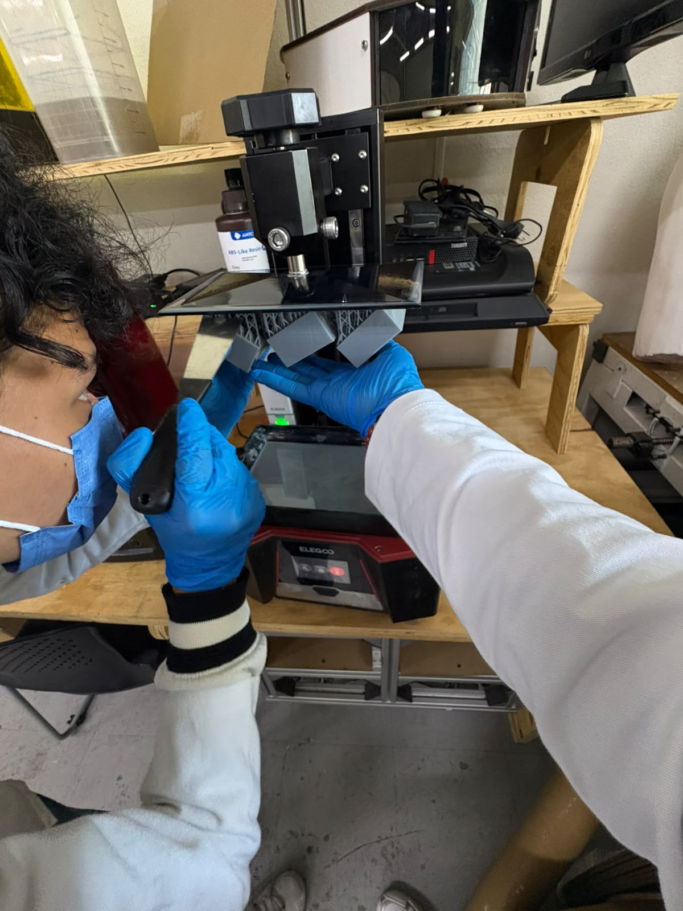  
*Figura 1: Impresora 3D Elegoo SLA durante la preparación de la impresión.*

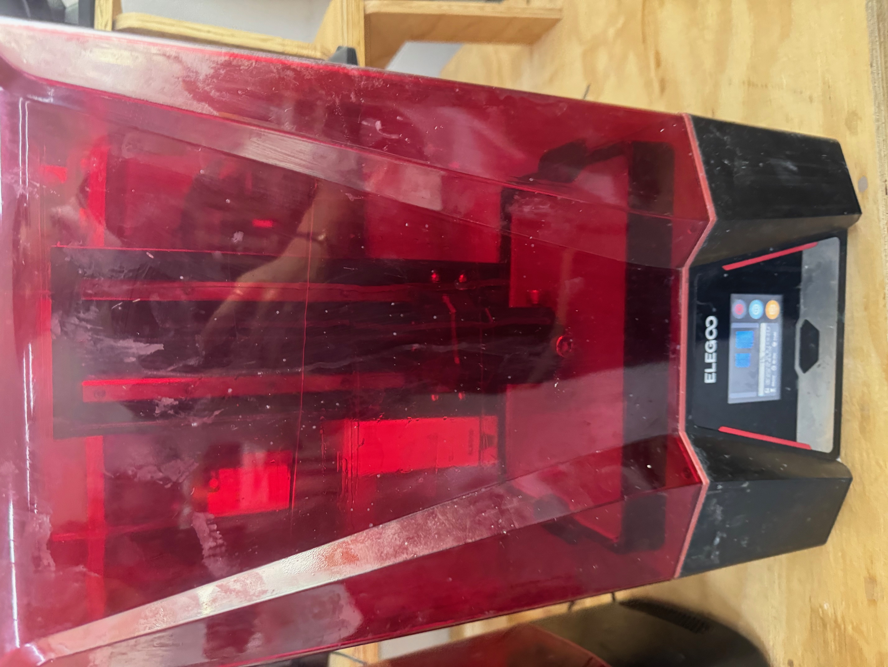  
*Figura 2: Extracción cuidadosa del contramolde impreso con espátula.*

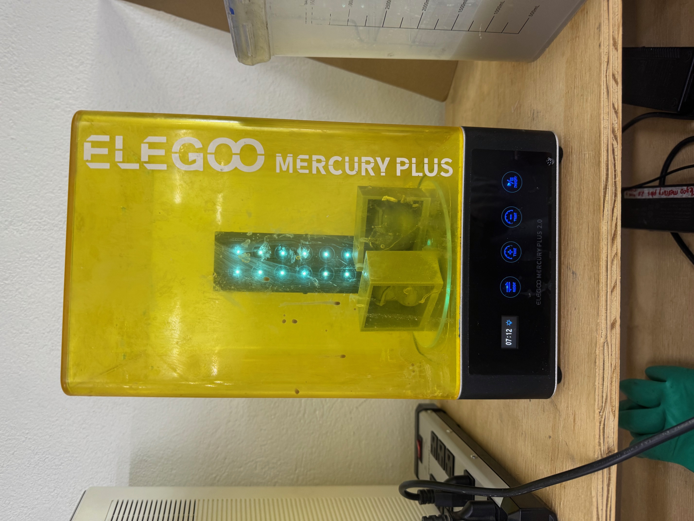  
*Figura 3: Proceso de post-curado UV durante 20 minutos en la Elegoo Mercury Plus.*

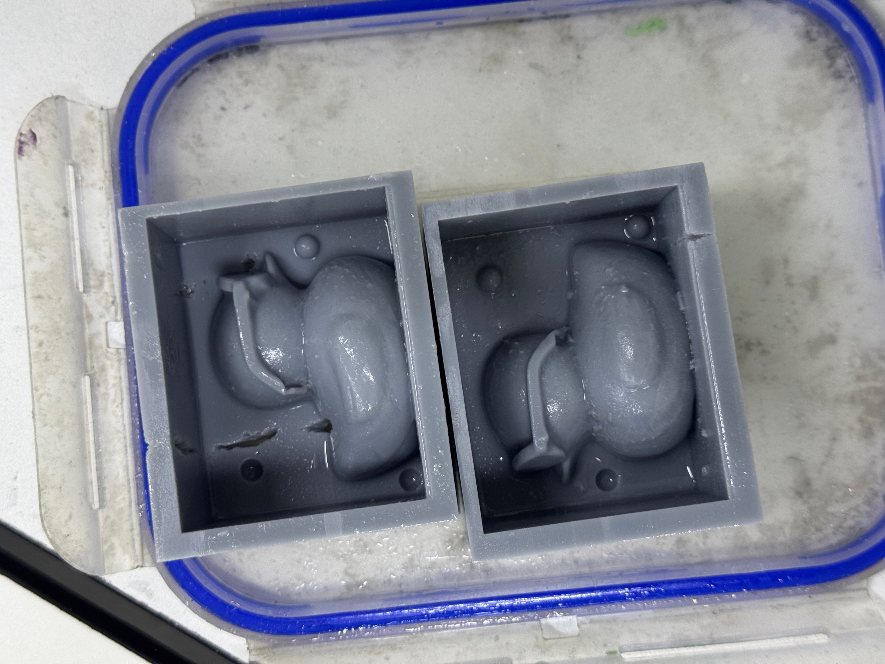  
*Figura 4: Contramolde impreso en resina SLA listo para la aplicación del silicona.*

### Paso 3: Mezcla y Vaciado del Molde de Silicona P48
1. Preparación del área de trabajo y uso de báscula de precisión.
2. Formulación de la mezcla ($\approx 250\text{ g}$ totales):
   * $70\%$ Caucho de silicona P48.
   * $28\%$ Solución para rebajar la viscosidad.
   * $2\%$ Catalizador.
3. Mezclado homogéneo evitando la incorporación excesiva de aire.
4. Vertido lento y controlado en el contramolde impreso para evitar atrapamiento de burbujas.
5. Tiempo de curado hasta solidificación del molde de silicona flexible.

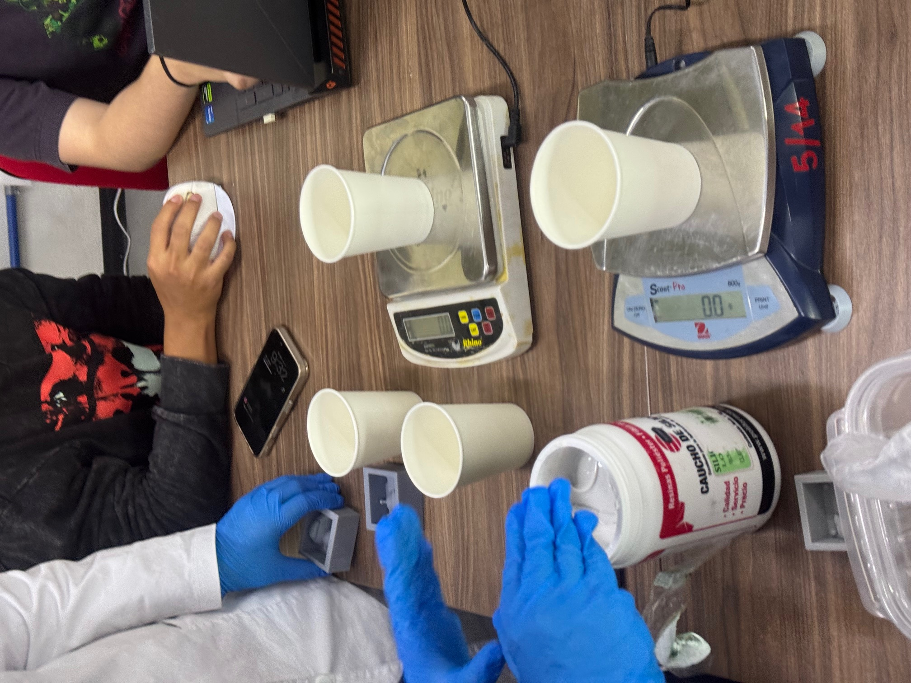  
*Figura 5: Dosificación y pesado con báscula para la mezcla de silicona P48.*

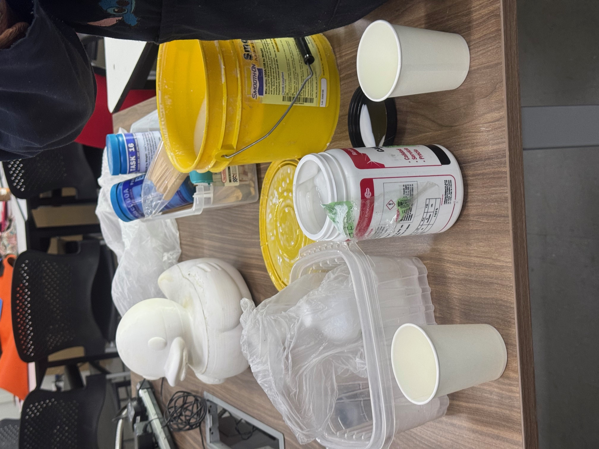  
*Figura 6: Insumos de silicona P48 y recipientes para mezcla.*

### Paso 4: Vaciado de la Pieza Final
1. Preparación de la resina para la figura final.
2. Vertido de la resina dentro del molde flexible de silicona P48.
3. Desmoldeo tras completar el tiempo de solidificación.

---

## 6. Conclusiones

* **Eficiencia de la Impresión SLA para Contramoldes:** La utilización de la impresora 3D de resina SLA y el slicer **Chitubox** permitió obtener un contramolde rígido con excelente acabado superficial y alta precisión geométrica. La etapa de curado de 20 minutos en la **Elegoo Mercury Plus** garantizó la estabilidad química de la pieza antes de recibir la silicona.
* **Comportamiento del Caucho P48:** La adición del $28\%$ de diluyente redujo la viscosidad de la silicona P48, facilitando el llenado de las cavidades del contramolde y reduciendo significativamente la presencia de burbujas sin perder elasticidad durante el desmoldeo de la figura final en resina.

[Descargar Modelo del contramolde(.zip)](../Archi/patolo.zip)

## 7. Vaciado Final: Resina Cristal y Fundición en Estaño

### A. Vaciado en Molde de Silicona (Resina Cristal con Colorante)

Para la pieza final en molde de silicona flexible, se utilizó **resina cristal** combinada con pigmento/colorante azul.

#### Proceso de Catalización y Pruebas:
1. **Primer intento ($1\%$ Catalizador):** Se preparó la resina agregando el catalizador al $1\%$ en peso. Sin embargo, la mezcla no logró curar adecuadamente, manteniéndose en estado viscoso.
2. **Segundo intento ($2\%$ Catalizador):** Se incrementó la dosificación del catalizador al **$2\%$**, logrando una polimerización correcta y una solidificación completa con excelente transparencia y brillo.

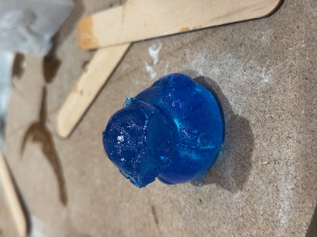  
*Figura 7: Resina empleada para el vaciado.*

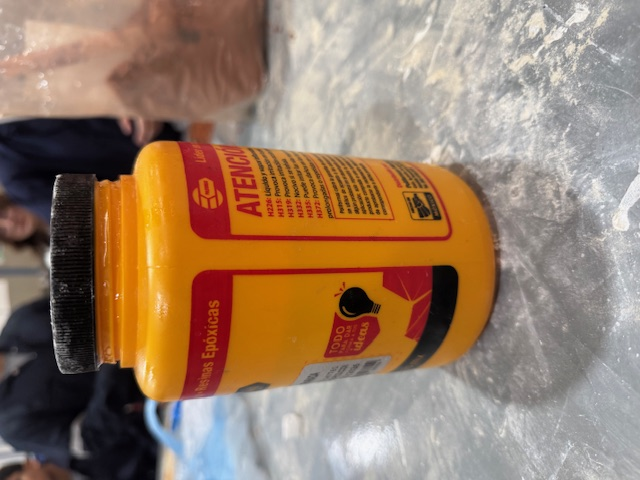  
*Figura 8: Catalizador K-2000 dosificado al 2%.*

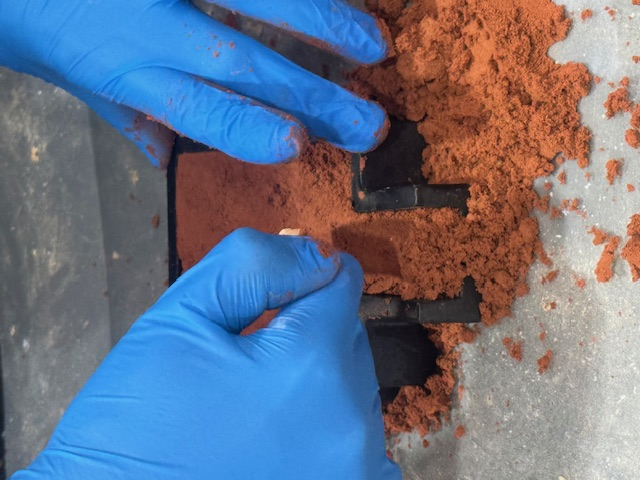  
*Figura 9: Resultado final de la pieza curada en resina cristal con pigmento azul.*

> ⚠️ **Precauciones y Seguridad para Resina Cristal:**
> * **Reacción Exotérmica:** Al activarse el catalizador, la resina genera una reacción química fuertemente exotérmica, incrementando considerablemente su temperatura. Es crucial evitar el contacto directo con la piel durante el curado para prevenir quemaduras.
> * **Vapores y Olor:** La resina libera vapores intensos que pueden provocar mareos e irritación. Es obligatorio el uso de **mascarilla con filtros para vapores orgánicos** y trabajar en un área debidamente ventilada.

---

### B. Vaciado en Metal (Estaño Fundido en Arena Silica / Verde)

En paralelo, se realizó un proceso de fundición de una pieza metálica en estaño utilizando el método de moldeo en arena sílica (arena verde para fundición).

#### Proceso Experimental:
1. **Compactación del Molde:** Se utilizó arena silica/verde apretando y compactando cuidadosamente la mezcla sobre la pieza patrón dentro de las cajas de moldeo para lograr una cavidad nítida.
2. **Fundición del Estaño:** Se colocó el estaño dentro del horno de fundición hasta alcanzar su punto de fusión.
3. **Vertido del Metal Liquidificado:** Con la ayuda de pinzas especiales para crisol, se extrajo el metal fundido del horno y se vertió con cuidado dentro del bebedero del molde de arena.

  
*Figura 10: Compactación manual de la arena verde en la caja de moldeo.*

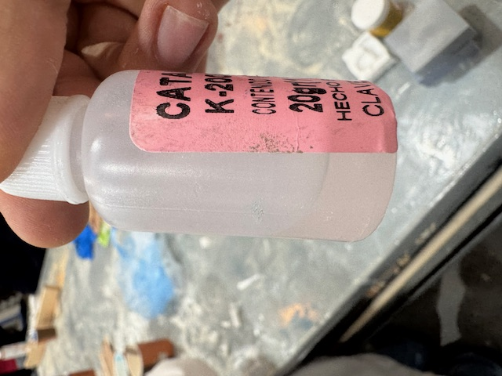  
*Figura 11: Cavidad del molde en arena sílica lista para el colado.*

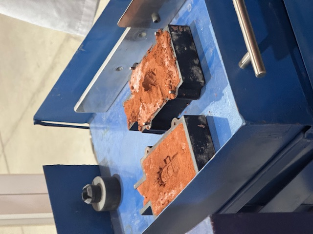  
*Figura 12: Introducción y manejo del crisol dentro del horno de fundición.*

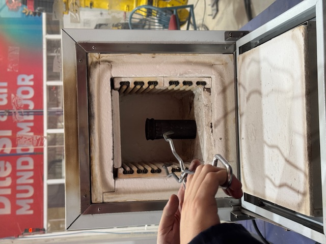  
*Figura 13: Extracción del estaño fundido a alta temperatura.*

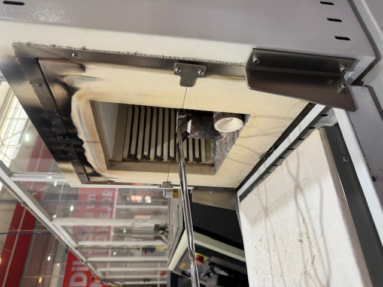  
*Figura 14: Colado de estaño recién vertido dentro de la caja de moldeo.*

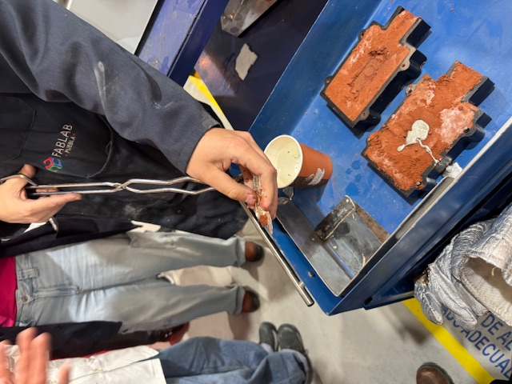  
*Figura 15: Apertura del molde de arena y revisión del vertido de estaño.*

>  **Precauciones y Seguridad para Fundición de Metal:**
> * **Equipo de Protección Personal (EPP):** Debido a las elevadas temperaturas del horno y del metal fundido, es indispensable contar con **guantes térmicos de calzado/asbesto o carnaza**, **careta de protección facial completa** y peto/mandil de seguridad.
> * **Manipulación:** La extracción del crisol e introducción al horno debe realizarse únicamente con **pinzas de sujeción especializadas** para evitar accidentes por derrame de metal incandescente.

---

### C. Evidencia en Video del Proceso

#### Video 1: Proceso de Fundición y Vaciado
<iframe width="560" height="315" src="https://www.youtube.com/embed/WwwmgBBiyQI?si=F7i03uQLBxmNWeR8" title="YouTube video player" frameborder="0" allow="accelerometer; autoplay; clipboard-write; encrypted-media; gyroscope; picture-in-picture; web-share" referrerpolicy="strict-origin-when-cross-origin" allowfullscreen></iframe>

#### Video 2: Desmoldeo y Resultado Final
<iframe width="560" height="315" src="https://www.youtube.com/embed/arreR8XdT1U?si=yAXbvCm9ROafj4ft" title="YouTube video player" frameborder="0" allow="accelerometer; autoplay; clipboard-write; encrypted-media; gyroscope; picture-in-picture; web-share" referrerpolicy="strict-origin-when-cross-origin" allowfullscreen></iframe>

