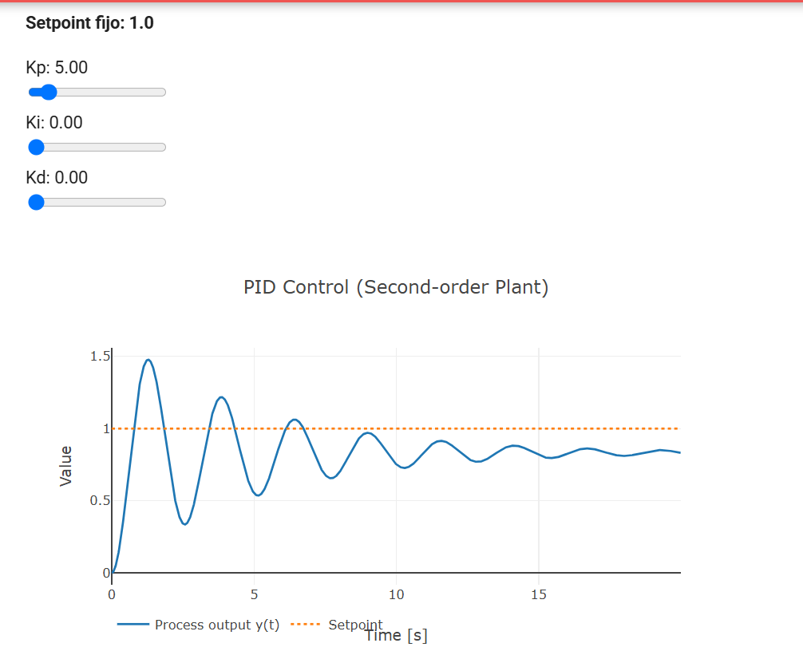
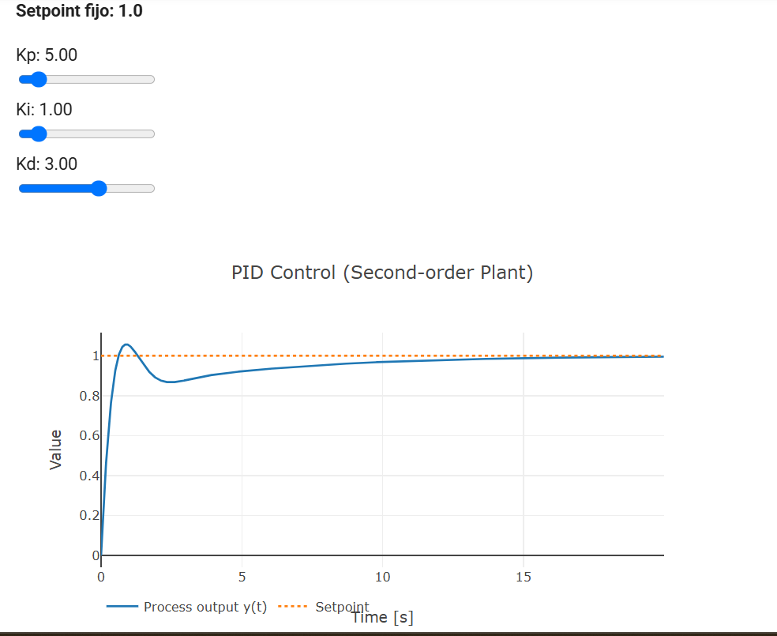
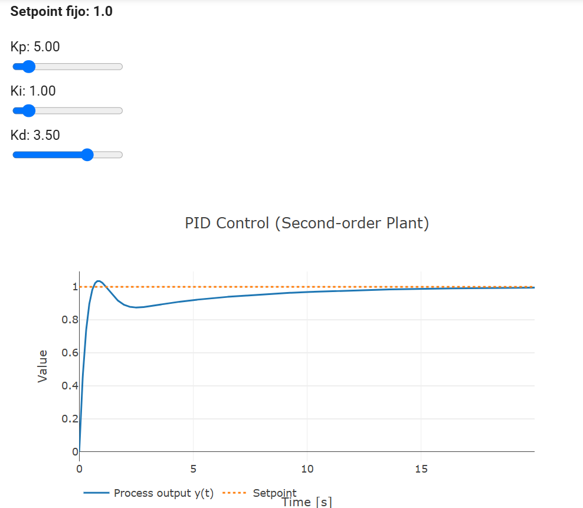
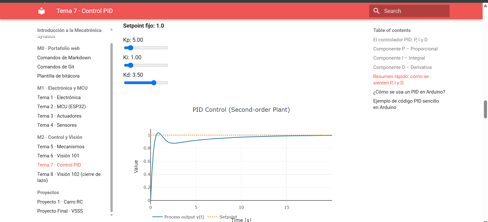
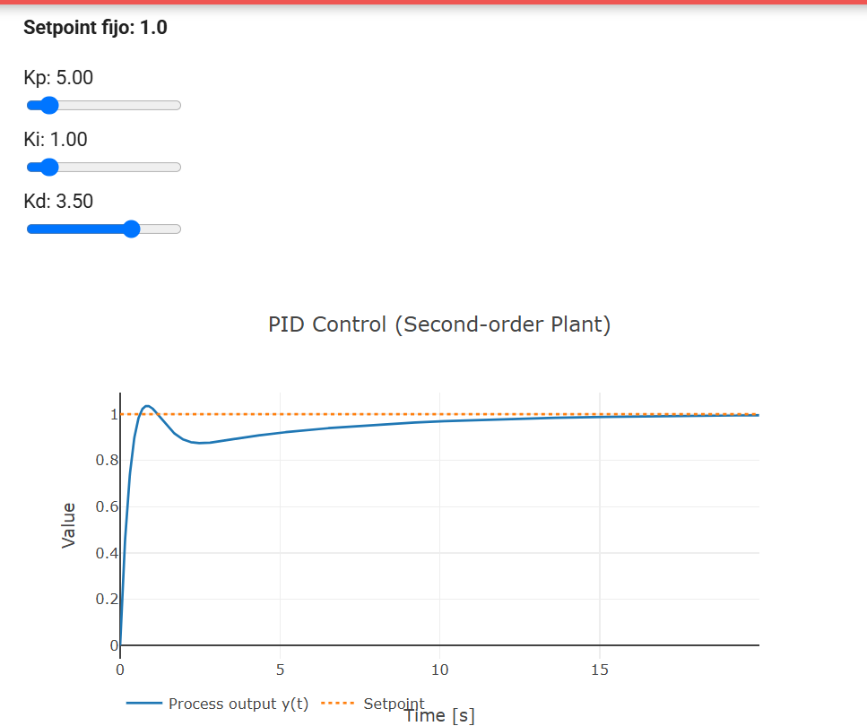
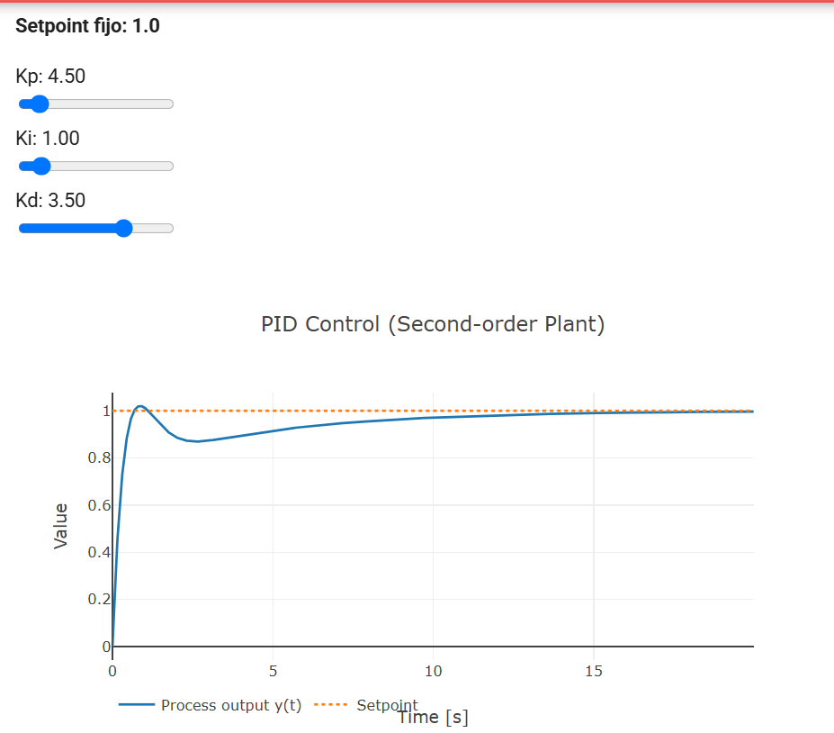

# Práctica de Control: Lazo Abierto y Lazo Cerrado (PID)

**Institución:** Universidad Iberoamericana Puebla (Ibero Puebla)  
**Materia:** Introducción a la Mecatrónica  
**Docente:** Maestra Miranda  
**Fecha de realización:** Viernes 30 de octubre de 2026  
**Plataforma:** ESP32 DevKit V1 | Driver TB6612FNG | Alimentación: 2x3.7V LiPo (7.4V)  

---

## Introducción

En esta práctica se evaluó el comportamiento de un sistema mecatrónico móvil tanto en **Lazo Abierto** (ejecución de comandos preprogramados por tiempo y PWM fijo) como en **Lazo Cerrado** (mediante simulación e implementación de un controlador PID). El objetivo principal es identificar el impacto de las perturbaciones externas (fricción, masa, desbalance de motores) y comprender cómo la retroalimentación permite corregir el error en estado estacionario y mejorar la respuesta dinámica del sistema.

---

## Parte A: Lazo Abierto con el Carrito ESP32

Se programó una secuencia temporal fija con un valor constante de PWM ($PWM = 180$) en el ESP32 para ejecutar la siguiente trayectoria:
1. Avanzar por 2 segundos.
2. Girar sobre su propio eje por 1 segundo.
3. Avanzar por 2 segundos.

Se realizaron pruebas bajo dos condiciones distintas: **piso liso de azulejo sin carga** y **piso liso de azulejo con carga (500 g)**. En cada caso se midió la desviación en centímetros con respecto al punto final meta esperado.

### Tabla de Registro de Desviaciones (Parte A)

| Condición | Intento | Desviación del punto final (cm) | Observaciones |
| :--- | :---: | :---: | :--- |
| **Piso liso de azulejo (sin carga)** | 1 | **18 cm** | Con voltaje nominal (7.4 V), la falta de tracción inicial provocó un leve derrape en las ruedas. |
| **Piso liso de azulejo (sin carga)** | 2 | **38 cm** | El giro duró sensiblemente más tiempo de lo esperado, desviando por completo la trayectoria final. |
| **Piso liso de azulejo con carga (500 g)** | 1 | **36 cm** | La inercia del peso adicional aumentó la desviación lineal respecto al punto meta. |
| **Piso liso de azulejo con carga (500 g)** | 2 | **21 cm** | El giro duró menos tiempo debido al peso extra sobre los motores, quedando más cerca de la orientación meta. |

### Conclusión sobre Lazo Abierto
Existe una alta variabilidad en los resultados debido a la falta de retroalimentación (sensores). El comportamiento de giro varía drásticamente: en ocasiones el giro es más pronunciado y en otras es más cerrado. Esta inconsistencia en el ángulo de rotación es la principal causa del cambio en la posición final esperada.

---

## Parte B: Lazo Cerrado con Demo PID

Se utilizó una demo interactiva de una planta de segundo orden para sintonizar un controlador PID aplicando la receta empírica: primero $P$, luego $D$ y finalmente $I$.

### Fórmula del Controlador PID

$$u(t) = K_p \cdot e(t) + K_i \int_{0}^{t} e(\tau) d\tau + K_d \frac{de(t)}{dt}$$

### Tabla de Registro de Sintonía (Parte B)

| Intento | Kp | Ki | Kd | Sobreimpulso (%) | Tiempo de establecimiento (s) | Error permanente | Observación |
| :---: | :---: | :---: | :---: | :---: | :---: | :---: | :--- |
| **1** | 5.0 | 0.0 | 0.0 | $\approx 48\%$ | $> 15$ s (No estabiliza) | Presente ($\approx 18\%$) | Control puramente proporcional. Muestra oscilaciones continuas y deja error en estado estacionario. |
| **2** | 5.0 | 1.0 | 3.0 | $\approx 6\%$ | $\approx 4.0$ s | Cero | Respuesta balanceada: la parte $D$ frena el sobreimpulso y la parte $I$ elimina el error permanente. |

### Elección de Parámetros Finales y Justificación
* **Parámetros elegidos:** $K_p = 5.0$, $K_i = 1.0$, $K_d = 3.0$
* **Justificación:** La ganancia $K_p = 5.0$ brinda una velocidad de reacción adecuada. Al incorporar $K_d = 3.0$, se amortiguan las oscilaciones iniciales, mientras que $K_i = 1.0$ acumula el error pasativo hasta erradicarlo por completo, estabilizando el sistema en un tiempo de $\approx 4.0\text{ s}$.

---

## Apartado EXTRA: Optimización de Parámetros

**Objetivo:** Lograr un sobreimpulso menor al $5\%$ y un tiempo de establecimiento menor a $5\text{ s}$.

### Proceso de Sintonía Fina
Tomando en cuenta la restricción de los sliders en la interfaz de usuario (incrementos de $0.5$ en $0.5$ para $K_p$), se incrementó la componente derivativa a $K_d = 3.50$ manteniendo $K_p = 5.00$ e $K_i = 1.00$.

### Tabla de Registro (EXTRA)

| Intento | Kp | Ki | Kd | Sobreimpulso (%) | Tiempo de establecimiento (s) | Error permanente | Observación |
| :---: | :---: | :---: | :---: | :---: | :---: | :---: | :--- |
| **Previo** | 5.0 | 1.0 | 3.0 | $\approx 6\%$ | $\approx 4.0$ s | Cero | Excelente tiempo, pero el sobreimpulso rebasa levemente el 5%. |
| **1** | 4.5 | 1.0 | 3.0 | $\approx 4.5\%$ | $\approx 5.3$ s | Cero | El sobreimpulso baja del 5%, pero la respuesta resulta lenta (> 5 s). |
| **Óptimo (EXTRA)** | **5.0** | **1.0** | **3.5** | **$\approx 4.1\%$** | **$\approx 4.5$ s** | **Cero** | **¡Meta Cumplida!** $K_d = 3.5$ brinda la amortiguación requerida para mantener el sobreimpulso $< 5\%$ y $t_s < 5\text{ s}$. |

---

## Evidencias Fotográficas y de Video

### Evidencia Fotográfica

*Figura 1: Respuesta del sistema únicamente con control proporcional ($K_p = 5.0$).*

*Figura 2: Respuesta del sistema con controlador PID completo ($K_p = 5.0, K_i = 1.0, K_d = 3.0$).*

*Figura 3: Ajuste óptimo cumpliendo el apartado EXTRA ($K_p = 5.0, K_i = 1.0, K_d = 3.5$).*

*Figura 4-6: Ajustes previos al optimo*
---

### Evidencia en Video

<iframe width="560" height="315" src="https://www.youtube.com/embed/cbQn0WWi4As?si=MvWnu59n66jOk0TL" title="YouTube video player" frameborder="0" allow="accelerometer; autoplay; clipboard-write; encrypted-media; gyroscope; picture-in-picture; web-share" referrerpolicy="strict-origin-when-cross-origin" allowfullscreen></iframe>

### Simulación Interactiva en Vivo

[Prueba la simulación interactiva PID aquí](https://tu-usuario.github.io/tu-repo/demo_pid.html)
