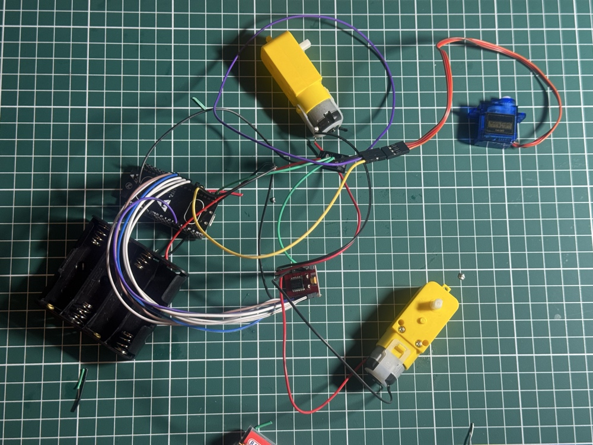
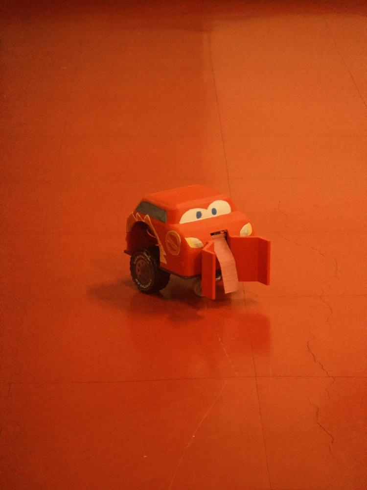
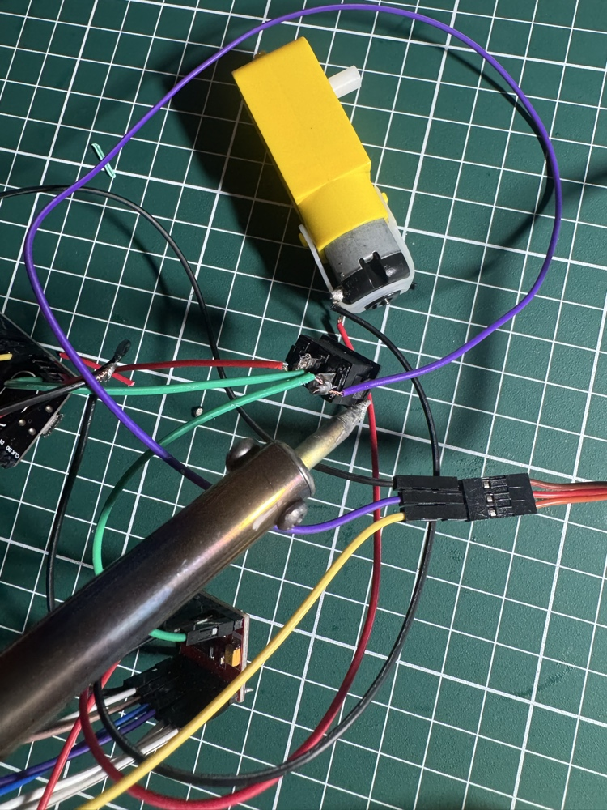
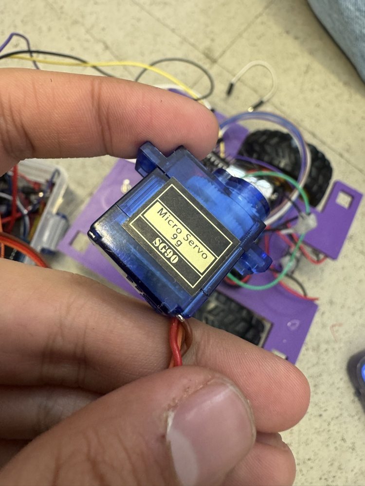
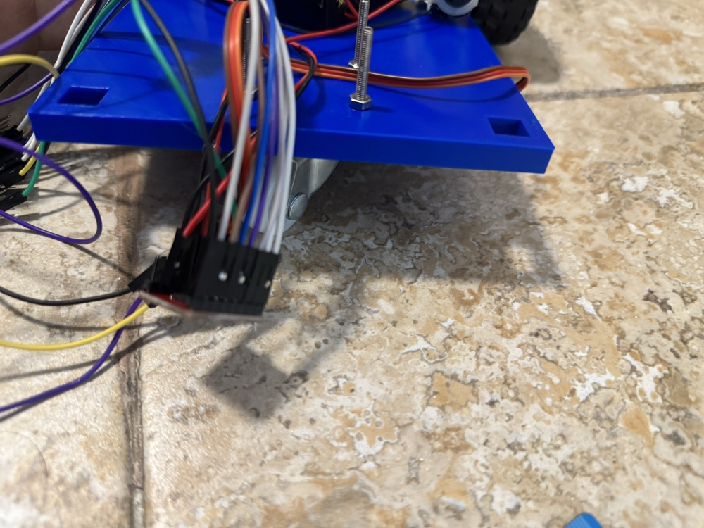
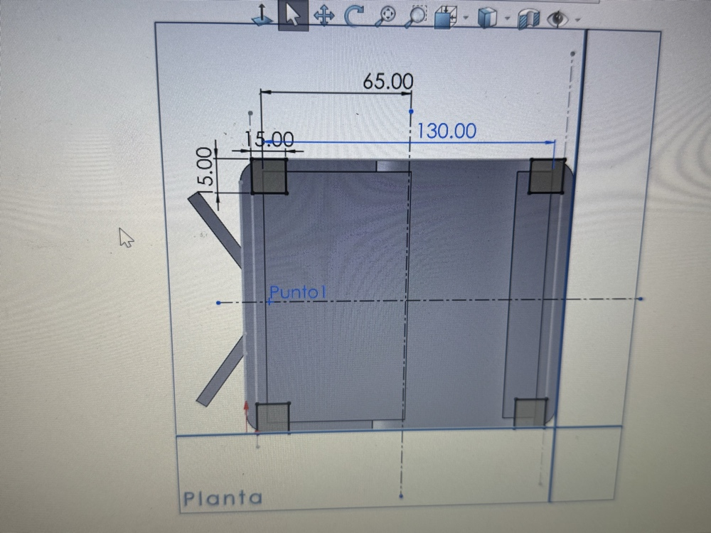
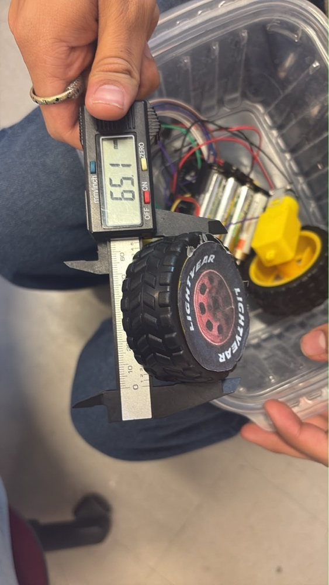
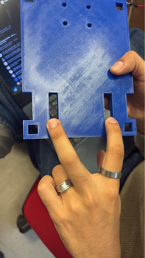
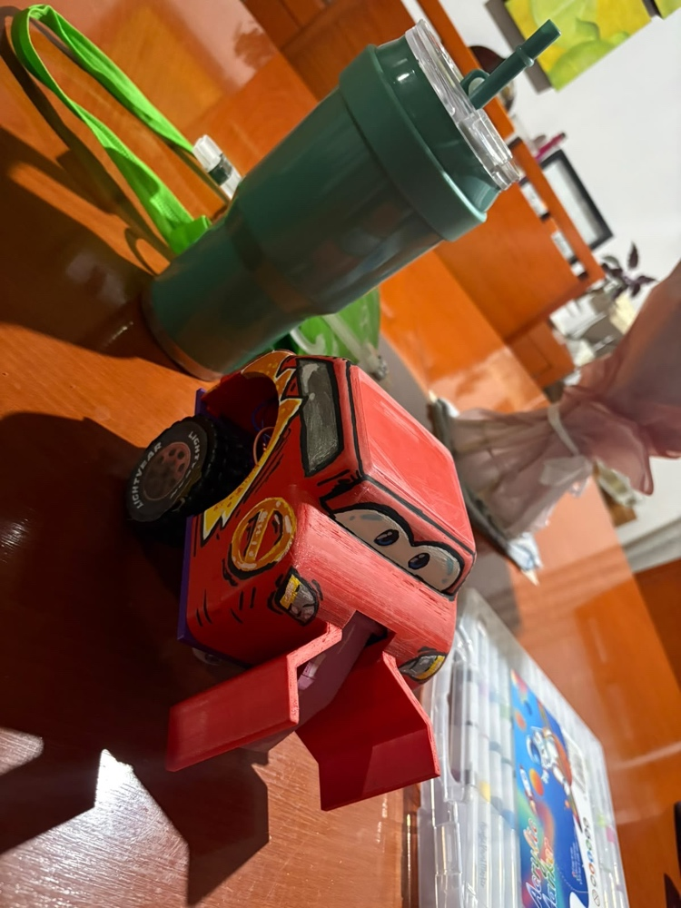
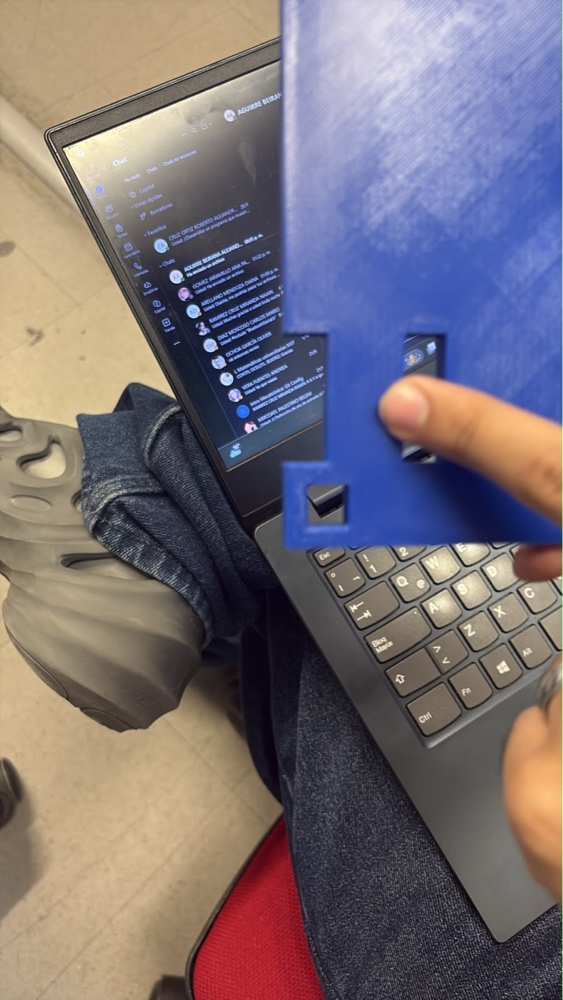

# Carrito de Fútbol Robótico - ESP32 

Repositorio oficial del proyecto de robot móvil tipo carrito desarrollado para la competencia de fútbol robótico. Este sistema integra un control inalámbrico mediante un mando de Xbox vía Bluetooth, tracción de alta precisión, un chasis defensivo diseñado en SolidWorks y un mecanismo de tiro dinámico accionado por servomotor.

---

## 1. Objetivo del Proyecto
Diseñar y construir un robot móvil tipo carrito para competir y ganar el torneo de fútbol robótico. El sistema integra un control inalámbrico preciso mediante Bluetooth (control de Xbox), un chasis ergonómico y defensivo, y mecanismos específicos para maniobrar y anotar goles, garantizando una alta competitividad y el cumplimiento estricto de los estándares de seguridad y funcionamiento.

---

## 2. Requisitos del Sistema

### 2.1. Requisitos Obligatorios (Funcionales y de Restricción)
- **R1. Control Bluetooth:** Movimiento en direcciones básicas (adelante, atrás, izquierda, derecha y alto) mediante comandos del mando de Xbox por Bluetooth.
- **R2. Control de Velocidad:** Variación de velocidad mediante PWM con 3 niveles definidos, gestionados mediante los botones superiores (RB para subir, LB para bajar).
- **R3. Documentación del Protocolo:** Documentación técnica completa en el repositorio sobre el mapeo de comandos y código fuente.
- **R4. Sistema Failsafe:** Detención automática inmediata del vehículo si se pierde la conexión inalámbrica con el control.
- **R5. Interruptor Físico:** Interruptor principal de encendido/apagado accesible desde el exterior sin necesidad de desarmar la estructura.
- **R6. Alimentación Separada:** Líneas de alimentación independientes para motores (pilas AA) y para el microcontrolador ESP32 (PowerBank), compartiendo una línea de tierra (GND) común.
- **R7. Cableado Ordenado:** Enrutamiento de cables protegido y optimizado sin protoboard, soldando al aire y uniendo pines mediante jumpers hembra-hembra para ahorrar espacio.
- **R8. Superficie Plana Superior:** Área plana horizontal despejada en la parte superior para colocar el marcador ArUco del proyecto.
- **Restricción de Dimensiones:** Huella máxima de $20 \times 20\text{ cm}$ para asegurar maniobrabilidad en cancha.

### 2.2. Requisitos Propios e Innovaciones
- **Tracción Omnidireccional / Ruedas Especiales:** Integración de llantas con desplazamiento fluido y rueda loca delantera.
- **Control Inalámbrico Avanzado (Mando de Xbox):** Sustitución de la aplicación móvil original por un control de Xbox para eliminar problemas de latencia y pérdida de conexión.
- **Mecanismo de Tiro Dinámico:** Sistema de pateo frontal accionado por un servomotor SG90 (simulando la palanca de un pinball) y activado mediante el gatillo derecho. Boost de velocidad con el gatillo izquierdo.
- **Chasis Defensivo y Protegido:** Diseño exterior ergonómico con una pinza frontal para la portabilidad del balón, protegiendo la electrónica y diseñado en SolidWorks.

---

## 3. Arquitectura del Sistema (Diagrama en Bloques)

1. **Capa de Control (Interfaz de Usuario)**
   - **Mando Inalámbrico:** Control de Xbox conectado por Bluetooth (BLE).
   - **Mapeo de Entradas:** Palanca izquierda para movimiento direccional, RB/LB para velocidad, LT para Turbo, RT/Botón A para mecanismo de tiro, Botón B para paro de emergencia.

2. **Capa de Procesamiento y Lógica**
   - **Microcontrolador ESP32 DevKit V1:** Procesa las señales del control, calcula los valores PWM de los motores, controla el servo de tiro y ejecuta la rutina Failsafe.

3. **Capa de Etapa de Potencia y Actuación**
   - **Driver TB6612FNG:** Recibe señales PWM y GPIO del ESP32 para controlar la velocidad y dirección de los motores.
   - **Actuadores:** 2 Motores TT con caja reductora y servomotor SG90 para el mecanismo de tiro.

4. **Sistema de Alimentación (Líneas Separadas con GND Común)**
   - **Línea de Lógica:** PowerBank independiente para alimentar el ESP32 DevKit V1.
   - **Línea de Potencia:** 4 pilas AA recargables para alimentar el driver TB6612FNG, motores y servo.
   - **Referencia Común:** Conexión de masa compartida (GND Común) entre ambas fuentes.

---

## 4. Presupuesto Real y BOM (Bill of Materials)

| Componente | Función / Descripción | Estado / Origen | Costo Real (MXN) |
| :--- | :--- | :--- | :--- |
| **ESP32 DevKit V1** | Microcontrolador principal | Prestado / Universidad | \$0.00 |
| **Driver TB6612FNG** | Controlador de potencia para motores | Prestado / Universidad | \$0.00 |
| **Motores TT (2 uds.)** | Sistema de tracción con caja reductora | Prestado / Universidad | \$0.00 |
| **Llantas y Ruedas** | Desplazamiento y tracción | Comprado | \$40.00 |
| **Rueda Loca** | Soporte y giro frontal | Comprado | \$15.00 |
| **Servomotor SG90** | Mecanismo de tiro (pateador) | Comprado | \$30.00 |
| **Pilas Recargables AA (4 uds.)** | Alimentación de motores y potencia | Comprado | \$300.00 |
| **Portapilas AA** | Contenedor de baterías | Comprado | \$20.00 |
| **Jumpers (Hembra-Hembra)** | Conexiones eléctricas sin protoboard | Comprado | \$30.00 |
| **Barras de Silicón** | Sujeción y seguridad estructural | Comprado | \$5.00 |
| **Chasis Impreso en 3D** | Estructura defensiva ($20 \times 20\text{ cm}$) | Impresión propia (Ibero Puebla) | \$0.00 |
| **Pintura Acrílica y Soldadura** | Estética y uniones fijas | Reutilizado / Material escolar | \$0.00 |
| **TOTAL REAL GASTADO** | | | **\$440.00 MXN** |

---

## 5. Implementación del Código (Firmware)

El código fuente principal desarrollado en C++ (Arduino IDE / VS Code) para el ESP32 se encuentra en la carpeta `src/` o en el archivo principal. A continuación se muestra un resumen de las librerías y configuración base utilizadas:

```cpp
#include <Arduino.h>
#include <BLEGamepadClient.h>
#include <ESP32Servo.h>
#include <BluetoothSerialConnect.h>

// Definición de pines para el driver TB6612FNG y servomotor SG90
const int pinPWMA = 14;
const int pinAIN1 = 27;
const int pinAIN2 = 26;
const int pinBIN1 = 25;
const int pinBIN2 = 33;
const int pinPWMB = 32;
const int pinSTBY = 4;
const int pinSERVO = 13;
```

---

## 6. Decisiones de Diseño e Innovación Durante el Desarrollo

- **Cambio de App Móvil a Control de Xbox:** Durante las pruebas iniciales se diseñó una aplicación en MIT App Inventor; sin embargo, se identificó alta latencia y pérdida de conexión Bluetooth. Se migró exitosamente a un mando de Xbox por BLE, garantizando un control firme, ergonómico y con respuesta inmediata.
- **Optimización de Espacio (Sin Protoboard):** Se eliminó el uso de protoboards para evitar falsos contactos por vibración en la cancha. Todo el circuito se ensambló mediante soldadura al aire y unión directa de pines con cables jumper hembra-hembra.
- **Mecanismo de Tiro Tipo Pinball:** Se implementó un brazo accionado por un servo SG90 en la parte frontal del carrito, integrado con una pinza recolectora para facilitar el transporte del balón de fútbol.
- **Alimentación Aislada:** Se empleó una PowerBank dedicada exclusivamente al ESP32 para evitar reinicios por picos de corriente generados al arrancar los motores de corriente directa alimentados por las pilas AA.

---

## 7. Criterios de Éxito y Conclusiones
- Cumplimiento exitoso de los requisitos funcionales (R1 a R8) y restricciones de dimensiones ($20 \times 20\text{ cm}$).
- Excelente estabilidad de conexión inalámbrica gracias al control de Xbox y el sistema Failsafe.
- Desempeño óptimo en cancha, logrando una estructura defensiva robusta, bajo costo de producción ($440 MXN totales) y gran agilidad ofensiva.

se uso claude para el diseño del codigo del carrito y su programación

## 8. Evidencias Fotográficas

A continuación se presentan las evidencias fotográficas del desarrollo, ensamble y pruebas finales del carrito de fútbol robótico:


*Figura 1: Circuito inicial montado sin protoboard, realizando soldadura al aire y unión por jumpers.*


*Figura 2: Carrito terminado y pintado con acabado inspirado en temática de carreras.*


*Figura 3: Proceso de soldadura de componentes y conexiones de energía.*


*Figura 4: Detalle del servomotor SG90 utilizado para el mecanismo de tiro tipo pinball.*


*Figura 5: Vista inferior del chasis impreso en 3D mostrando el montaje y cableado.*


*Figura 6: Plano de diseño CAD en SolidWorks con acotaciones del chasis (20 x 20 cm).*


*Figura 7: Medición de dimensiones de rueda mediante vernier.*


*Figura 8: Validación física de las ranuras y dimensiones del chasis impreso.*


*Figura 9: Vista lateral del carrito con su pinza recolectora frontal y acabado final.*


*Figura 10: Prueba de ensamblaje del chasis en la universidad frente a estación de trabajo.*

---
